<br />

<p align="center">
  <a href="#01--about"><code>about</code></a>&nbsp;&nbsp;·&nbsp;&nbsp;
  <a href="#02--stack"><code>stack</code></a>&nbsp;&nbsp;·&nbsp;&nbsp;
  <a href="#03--activity"><code>activity</code></a>
</p>

<br />

## 01 — about

```ts
const ali = {
  role:     "Web Developer",
  focus:    ["clean UI", "frontend architecture", "performance"],
  stack:    ["TypeScript", "React", "Next.js", "Node.js"],
  learning: ["system design", "motion & interaction"],
  status:   "open to collaborations",
} as const;
```

<br />

## 02 — stack

<p align="left">
  
</p>

<br />

## 03 — activity

<p align="center">
  
  
</p>

<p align="center">
  
</p>

<br />


